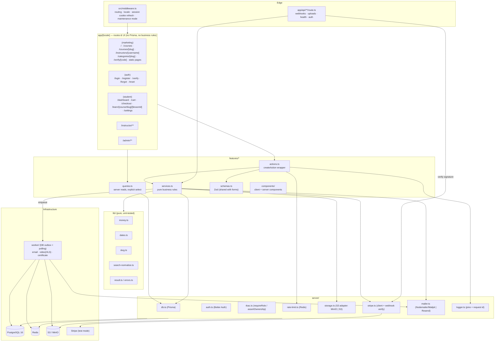
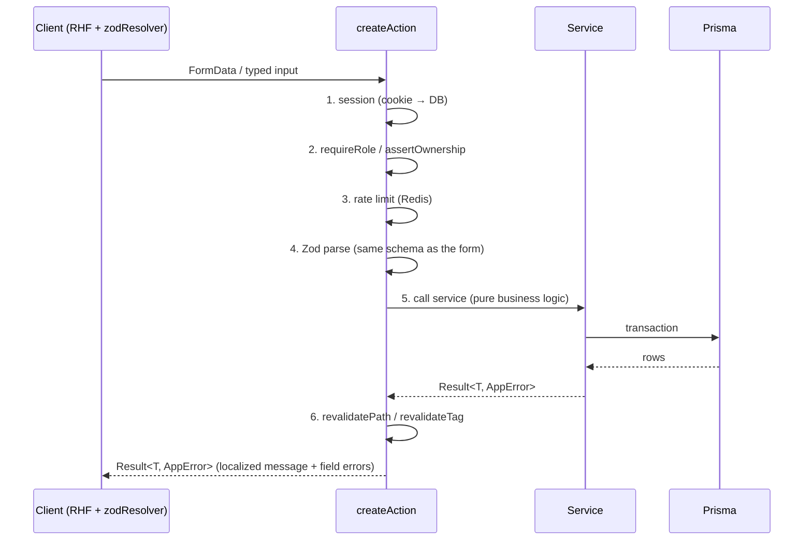
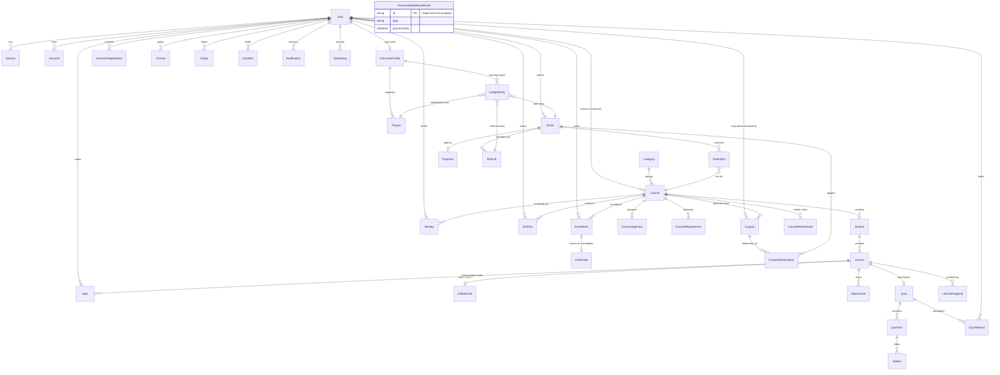
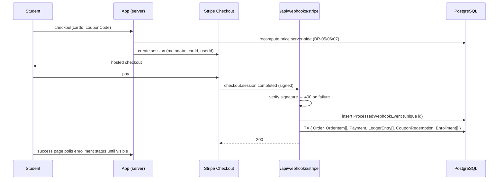

# ARCHITECTURE — Midad

> This document is the contract for where code lives and which direction dependencies flow. The ER
> diagram and migration list are generated from the Prisma schema.

## 1. Principles

1. **Server is the source of truth.** Every authorization check, price calculation, quiz
   score, and progress computation runs on the server. The UI renders; it never decides.
2. **One direction of dependency.** `app → features/*/actions → features/*/services → server/db`.
   A service never imports React or `next/*`; an action never touches Prisma directly.
3. **Zod schemas are shared** between the form and the server so client and server cannot drift.
4. **No feature without a test.** Every business rule (BR-01…BR-21) has at least one unit test
   whose name begins with the rule id, plus an integration test for the action that enforces it.
5. **Bilingual by construction.** Arabic is a first-class locale, not a later translation pass.

## 2. Layer diagram



### 2.1 `createAction` pipeline (mandatory order)



`AppError` variants: `UNAUTHORIZED | FORBIDDEN | NOT_FOUND | VALIDATION | CONFLICT | RATE_LIMITED | PAYMENT | INTERNAL`.
Each maps to a translated message key; unexpected errors are logged with pino and returned as a
generic message plus the request id. Raw Prisma/driver errors never reach the client.

## 3. Folder structure

```text
.
├─ README.md  CHANGELOG.md
├─ docs/            ARCHITECTURE.md  DESIGN_SYSTEM.md  BUSINESS_RULES.md  DECISIONS.md
│                   TEST_PLAN.md  DEPLOYMENT.md  ASSETS.md  SECURITY.md
├─ docker-compose.yml  .env.example  .github/workflows/ci.yml
├─ prisma/          schema.prisma  migrations/  seed/ (seed.ts + data/*.ts)
├─ messages/        ar.json  en.json
├─ public/          lottie/  icons/  images/  fonts/
├─ worker/          index.ts (video HLS · certificate PDF · email outbox)
├─ tests/           unit/  integration/  e2e/  a11y/  visual/  load/
└─ src/
   ├─ app/[locale]/{ (auth), courses/[slug], categories/[slug], instructors/[username],
   │                 teach, settings, wishlist, instructor, admin, about, faq, contact, terms, privacy }
   ├─ app/api/{ auth/[...all], account/export, health }
   ├─ features/{ auth, account, catalog, instructor, contact, wishlist }/
   │             (each: components/ actions.ts schema.ts)
   ├─ components/{ ui/ (shadcn), layout/, shared/, catalog/, marketing/ }
   ├─ server/       db.ts auth.ts rbac.ts rate-limit.ts limiter.ts storage.ts account.ts
   │                catalog.ts home.ts instructors.ts wishlist.ts mailer.ts logger.ts
   ├─ lib/          money.ts dates.ts slug.ts search-normalize.ts result.ts errors.ts
   ├─ i18n/         routing.ts request.ts
   ├─ config/       site.ts nav.ts
   ├─ styles/       globals.css (design tokens)
   ├─ env.ts
   └─ middleware.ts
```

## 4. Data model

### 4.1 Domain groups

| Group    | Entities                                                                                                                                                 |
| -------- | -------------------------------------------------------------------------------------------------------------------------------------------------------- |
| Identity | `User`, `Session`, `Account`, `Verification`, `InstructorProfile`, `InstructorApplication`                                                               |
| Catalog  | `Category`, `Course`, `CourseObjective`, `CourseRequirement`, `Section`, `Lesson`, `VideoAsset`, `Attachment`, `CourseReviewNote`                        |
| Learning | `Enrollment`, `LessonProgress`, `Quiz`, `Question`, `Option`, `QuizAttempt`, `Certificate`, `Note`, `Thread`, `Reply`, `Review`, `Wishlist`, `StreakDay` |
| Commerce | `CartItem`, `Coupon`, `CouponRedemption`, `Order`, `OrderItem`, `Payment`, `Refund`, `LedgerEntry`, `Payout`, `ProcessedWebhookEvent`                    |
| System   | `Notification`, `Announcement`, `Report`, `ContactMessage`, `AuditLog`, `PlatformSetting`                                                                |

### 4.2 ER diagram



### 4.3 Key constraints (enforced in `schema.prisma`, not only in app code)

- `Enrollment`: `@@unique([userId, courseId])` — BR-09.
- `Review`: `@@unique([userId, courseId])` — BR-18.
- `Certificate`: `@@unique([userId, courseId])` and `@unique code` — BR-17.
- `CouponRedemption`: `@@unique([couponId, userId])` for per-user caps, plus a counter guarded
  inside the purchase transaction — BR-07.
- `Course.slug` unique; `User.username` unique; `Category.slug` unique.
- `ProcessedWebhookEvent.id` unique → idempotent webhooks — BR-08.
- All money columns are `Int` (minor units) — BR-05. No `Float` anywhere in the schema.
- `OrderItem` freezes `unitPriceCents`, `discountCents`, `instructorShareCents`,
  `commissionBps` at sale time — BR-11.
- `LedgerEntry` is append-only: no `UPDATE`/`DELETE` path in any service; balance is always
  a `SUM()` — BR-12.
- Soft delete on `User.deletedAt`; blocked users keep rows but sessions are invalidated — BR-21.

### 4.4 Indexes (mandatory)

- Every foreign key.
- Every column used in `where` / `orderBy`: `Course(status, publishedAt)`, `Course(categoryId, status)`,
  `Course(ratingAvg)`, `Course(priceCents)`, `Lesson(sectionId, order)`, `Enrollment(userId, status)`,
  `LessonProgress(enrollmentId, lessonId)`, `Order(userId, createdAt)`, `LedgerEntry(instructorProfileId, createdAt)`,
  `Notification(userId, readAt)`, `AuditLog(actorId, createdAt)`.
- Full-text search: `pg_trgm` extension plus a normalized column `Course.titleNormalized` /
  `Course.descriptionNormalized` produced by `lib/search-normalize.ts` (Arabic: strip tashkeel and
  tatweel, `أإآ→ا`, `ة→ه`, `ى→ي`) with a GIN trigram index — the product requirements.
- Partial unique index for "one pending payout per instructor" — BR-13.

### 4.5 Naming, migrations and database-level guards

**Naming.** Tables are snake_case through Prisma's `@@map`; columns keep Prisma's camelCase and are
therefore quoted in raw SQL (`"priceCents"`). Prisma is the only writer in application code, so the
quoting cost is confined to migrations, `tools/db-invariants.sql` and operational queries.

**Migrations** (`prisma/migrations`, forward-only, never edited once applied):

| Migration                                           | Contents                                                                                                                                 |
| --------------------------------------------------- | ---------------------------------------------------------------------------------------------------------------------------------------- |
| `20261109133301_init`                               | 44 tables, all enums, every index from §4.4, `pg_trgm` extension and the two GIN trigram indexes on the normalised Arabic search columns |
| `20261109133400_integrity_guards`                   | the guards Prisma cannot express (below)                                                                                                 |
| `20261109230107_account_settings`                   | bio and notification preferences on `users` (the product requirements)                                                                   |
| `20261109235500_instructor_application_pending_idx` | one PENDING instructor application per user                                                                                              |

**Guards that live in Postgres, not in application code:**

1. `payouts_one_open_per_instructor_idx` — partial unique index on `("instructorProfileId") WHERE
status IN ('REQUESTED','APPROVED')` → BR-13 holds even under concurrency.
2. `instructor_applications_one_pending_per_user_idx` — partial unique index on `("userId") WHERE
status = 'PENDING'` → a learner cannot end up with two applications awaiting review.
3. CHECK constraints: review rating 1–5 (BR-18), non-negative money columns (BR-05), coupon
   percentage 1–100 / positive fixed amount / exactly one value per type / `endsAt > startsAt`
   (BR-07), quiz pass mark 1–100 and attempts ≥ 1 (BR-16), non-negative order totals (BR-06).
4. `ledger_entries_no_update` trigger raises on UPDATE/DELETE of `ledger_entries` → BR-12 cannot be
   broken by a future migration or a raw query.

Everything above is verified by `pnpm db:verify` (`tools/db-invariants.sql`), which inserts fixtures
inside a transaction, attempts each forbidden operation, asserts the rejection, and rolls back.
Eight checks currently pass.

**Not expressible / deliberately absent:** row-level security (authorization is enforced in
`server/rbac.ts` and per-service ownership checks, the product requirements), and triggers for denormalised
counters — those are updated inside the same transaction as their source rows (BR-18).

## 5. Video pipeline

Upload is a presigned **multipart** PUT straight from the browser to the private bucket: 5 MiB parts,
two parallel XHRs, real per-part progress and a cancel that aborts the multipart server-side.
Completion does not trust browser ETags — the server calls `ListParts` and completes with S3's own
part list. An interrupted upload is resumable: the asset keeps its upload id, `ListParts` reports
what already landed, and the instructor reselects the same file so the browser can send the missing
parts (`src/server/video-upload.ts`).

`worker/index.ts` polls assets in `PROCESSING`, downloads the original, runs `ffmpeg` to a 720p HLS
playlist plus a thumbnail, uploads them under `hls/{assetId}/`, flips the asset to `READY|FAILED`,
and updates the lesson and course durations. It is a separate process (`pnpm worker`); the Playwright
stack starts it with the servers. A single worker is expected — distributed job claiming is not
implemented (Known Issue KI-04).

Playback never exposes the object key: BR-20 requires short-lived signed URLs (15 min) issued
per lesson after an enrollment check; preview lessons are the only public ones. The player is
LTR in both locales because time runs left-to-right in every player — recorded as ADR-0005,
together with the Mux adapter switch (`VIDEO_PROVIDER=hls|mux`).

## 6. Commerce flow (BR-08)



The success page **never** creates enrollments; it only polls. Replaying the event is a no-op
because the unique `event id` insert conflicts — verified by an integration test that fires the
same event ten times concurrently and asserts exactly one enrollment.

## 7. Cross-cutting concerns

| Concern            | Where                                       | Notes                                                                                 |
| ------------------ | ------------------------------------------- | ------------------------------------------------------------------------------------- |
| Localization       | `i18n/`, `messages/*.json`, `next-intl`     | `/ar` and `/en` prefixes; `<html lang dir>` set on the server                         |
| Theming            | `styles/globals.css` tokens + `next-themes` | no flash on load (inline script + cookie)                                             |
| Rate limiting      | `server/rate-limit.ts` (Redis)              | login 5/min/IP, register, forgot-password, contact, coupon, quiz submit               |
| Observability      | `server/logger.ts` (pino)                   | one request id per request, surfaced to the user on 500                               |
| Uploads validation | `features/uploads`                          | magic-byte sniffing, not extension: video ≤ 4GB, image ≤ 5MB, PDF ≤ 50MB              |
| HTML sanitization  | `features/curriculum`                       | all Tiptap output sanitized server-side before storage                                |
| Audit trail        | `features/admin`                            | `AuditLog` for publish, price change, role change, ban, impersonation, refund, payout |
| Maintenance mode   | `middleware.ts` + `PlatformSetting`         | signed-in admins bypass; everyone else gets the maintenance page                      |

## 8. Environments

| Env        | Postgres          | Redis             | Storage                                                                                             | Mail                        | Stripe                                       |
| ---------- | ----------------- | ----------------- | --------------------------------------------------------------------------------------------------- | --------------------------- | -------------------------------------------- |
| local      | Docker `:5433`    | Docker `:6380`    | MinIO-compatible at `:9000`, buckets auto-created (`midad-public` anon-read, `midad-media` private) | Mailpit `:1025`, UI `:8025` | test mode + `stripe-cli` (`pnpm dev:stripe`) |
| ci         | service container | service container | same image + init job                                                                               | Mailpit                     | mocked CLI-forwarded events                  |
| production | managed           | managed           | S3-compatible                                                                                       | Resend                      | live keys (out of scope)                     |

Local host ports are offset (5433/6380) so the stack coexists with a Postgres/Redis already
installed on the machine; every port is overridable from `.env` (ADR-0011).
Switching between environments is environment variables only — `src/env.ts` validates at boot.

## 9. Non-goals (explicit)

- No native mobile app; the web app is responsive only.
- No multi-tenant organizations; one platform, one commission rate at a time.
- No live video/cohort scheduling in v1; courses are self-paced.
- No DRM; content is protected by short-lived signed URLs and enrollment checks (BR-20).
